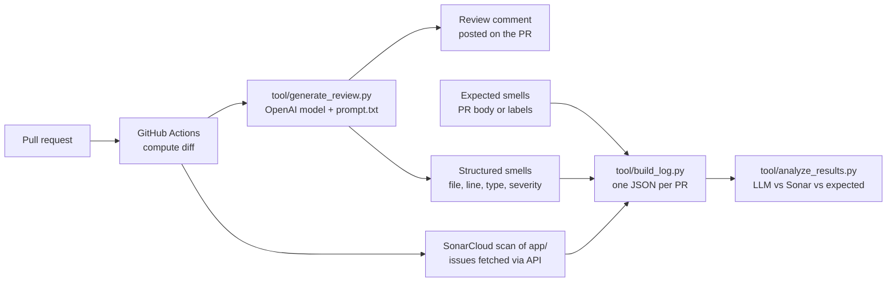

# LLM Pull Request Code Smell Reviewer

A GitHub Actions pipeline that reviews pull requests with an LLM, posts the review as a PR comment, and compares the code smells it finds with SonarCloud's.

Course project (Software Maintenance and Evolution, UFMG). Group project.
<!-- Add one line here with your own contribution. -->

## How it works

1. On every pull request, the workflow computes the diff.
2. `tool/generate_review.py` sends the diff to an OpenAI model (default `gpt-4o-mini`) using the prompt in `prompt.txt`. The model returns structured output: a list of smells (file, line, type, message, severity) and a Markdown comment.
3. The comment is posted on the PR.
4. SonarCloud scans `app/` and its issues for the PR are fetched through the API.
5. `tool/build_log.py` merges the expected smells (from a `SMELLS:` line in the PR body or `smell:` labels), the LLM smells and the Sonar issues into one JSON per PR, uploaded as a workflow artifact. `tool/analyze_results.py` compares them.



`app/` is a small task-management codebase used as the target. Smells were introduced on purpose: long parameter lists, god methods, duplicated code, high cyclomatic complexity and feature envy.

## Results

`analysis.csv` has 15 test cases (5 smell types × 3). The intended smell was detected by the LLM in 11 and by SonarCloud in 8. Neither detected feature envy. Only the LLM caught duplicated code (2 of 3). The sample is small and the results are indicative only.

## Setup

- Repository secrets: `OPENAI_API_KEY`, `SONAR_TOKEN`.
- Repository variable: `SONAR_PROJECT_KEY`; also set `sonar.projectKey` and `sonar.organization` in `sonar-project.properties`.

Run the reviewer locally on a diff:

```bash
cd tool
pip install -r requirements.txt
export OPENAI_API_KEY=...
python generate_review.py examples/sample_diff.diff
```
